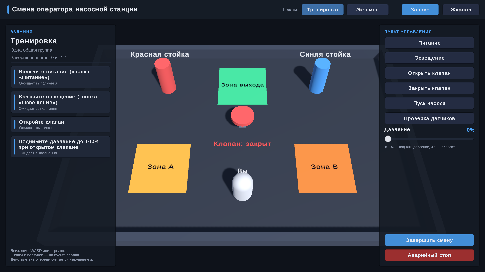
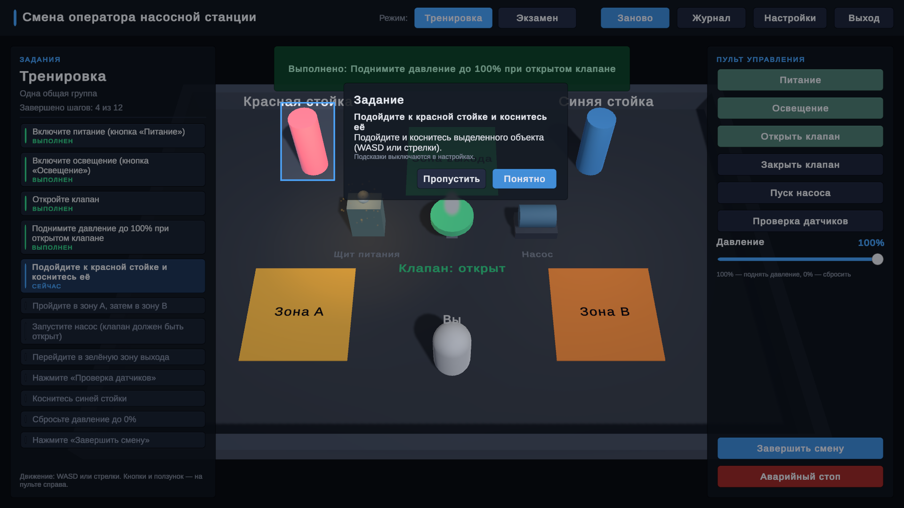
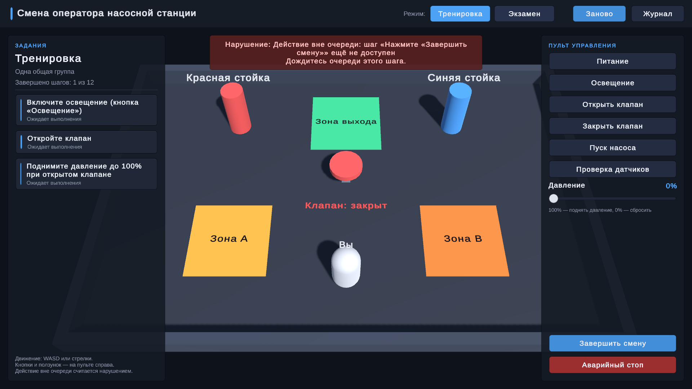
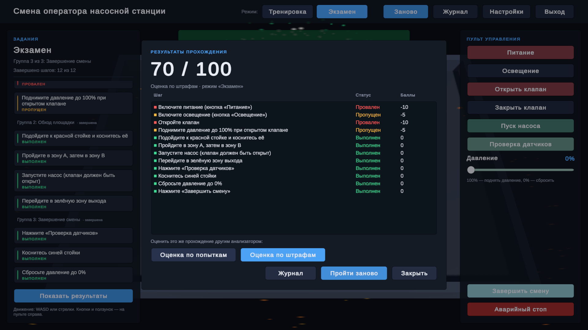
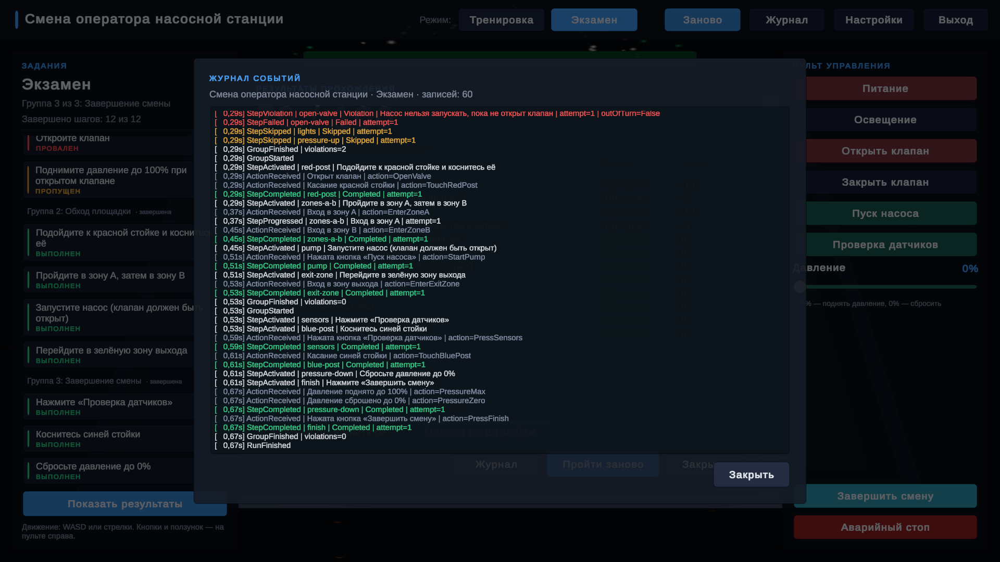

# Конструктор учебных сценариев (Unity)

Сценарий собирается из шагов прямо в редакторе Unity, без кода. Один и тот же набор шагов проходится
в двух режимах: в тренировке с подсказками и повторами и на экзамене с группами и штрафами. Всё, что
происходит, пишется в журнал, а готовое прохождение можно оценить заново другим алгоритмом.



| Обучающий тур | Экзамен: нарушение | Результаты | Журнал |
|---|---|---|---|
|  |  |  |  |

- Unity 6000.6.7f1, встроенный конвейер рендера, Input System, uGUI и TextMesh Pro.
- Сторонних ассетов и плагинов нет.
- Демо-сцена: `Assets/ScenarioBuilder/Demo/Scenes/DemoScenario.unity`.
- Веб-версия: https://kantaevsherhan.github.io/scenario-builder/ (раздел «Веб-версия» ниже).

## 1. Как запустить

1. Откройте папку проекта в Unity Hub.
2. Откройте сцену `Assets/ScenarioBuilder/Demo/Scenes/DemoScenario.unity` и нажмите Play.
3. Сцена стартует в тренировке. При первом запуске появится короткий тур по интерфейсу.

Управление:

- WASD или стрелки — ходить. Белая капсула — это вы.
- Пульт справа — кнопки и ползунок «Давление».
- Слева — список всех шагов. Синие нужно сделать сейчас, зелёные выполнены, красные провалены,
  оранжевые пропущены. На экзамене там же видно, какая группа идёт.
- Вверху — переключение режима, «Заново», «Журнал», «Настройки» и «Выход» (в веб-версии его нет).
- Esc закрывает открытое окно или тур, а если ничего не открыто — выходит из игры.
  В редакторе вместо выхода останавливается Play Mode, в браузере Esc только закрывает окна.

Объекты сцены реагируют на происходящее:

- то, что ждёт текущий шаг, мигает синим (кнопка на пульте, стойка, зона, клапан);
- выполненное становится зелёным, проваленное — красным;
- в момент действия объект вспыхивает, а при нарушении вспыхивает красным;
- при наведении мыши объекты подсвечиваются и показывают подсказку;
- у клапана идёт пар, у насоса — вода, на щите искрит при включении и при аварийном стопе,
  кнопка «Освещение» включает лампы, у зон и стоек свои вспышки.

В тренировке после каждого нового этапа тур показывает, что делать: затемняет экран, оставляет
вырез вокруг нужной кнопки или объекта и подписывает его. «Далее» переходит к следующему
заданию этапа, «Пропустить» закрывает подсказки до следующего этапа. В «Настройках» тур
и подсветку можно выключить, а тур — пройти заново.

### Демо-сценарий «Смена оператора насосной станции»

| # | Шаг | Чем выполняется | Что проверяет |
|---|---|---|---|
| 1 | Включите питание | кнопка | «Аварийный стоп» во время шага — нарушение |
| 2 | Включите освещение | кнопка | |
| 3 | Откройте клапан | кнопка, ставит состояние «Клапан открыт» | «Пуск насоса» во время шага — нарушение |
| 4 | Поднимите давление до 100% при открытом клапане | ползунок (UnityEvent) | условие на состояние сцены |
| 5 | Коснитесь красной стойки | столкновение | |
| 6 | Пройдите в зону A, затем в зону B | два триггера | порядок: B раньше A — нарушение |
| 7 | Запустите насос (клапан должен быть открыт) | кнопка | условие на состояние сцены |
| 8 | Перейдите в зону выхода | триггер | |
| 9 | Нажмите «Проверка датчиков» | кнопка | |
| 10 | Коснитесь синей стойки | столкновение | |
| 11 | Сбросьте давление до 0% | ползунок | |
| 12 | Нажмите «Завершить смену» | кнопка | |

Тренировка открывает шаги так же, как в примере из задания: 1–4 вместе, потом 5, 6, 7, 8 по одному,
потом 9 и 10 вместе, потом 11 и 12 вместе.

Экзамен разбит на три группы, порог — 2 нарушения:

- «Подготовка оборудования» — шаги 1–4 вместе;
- «Обход площадки» — шаги 5–8 по очереди;
- «Завершение смены» — 9 и 10, затем 11 и 12.

### Проверить контрольные примеры руками

- Тренировка, 10 + 5 + 0. Выполните шаг сразу — 10 баллов. Другой шаг сначала нарушьте (например,
  в шаге 6 зайдите в зону B раньше A), потом выполните — 5 баллов. Третий нарушьте дважды (в шаге 7 два
  раза нажмите «Пуск насоса» с закрытым клапаном) — 0 баллов. Баллы по шагам видны в окне результатов.
- Экзамен, 70 баллов. В первой группе нажмите «Аварийный стоп» (провален шаг 1), затем «Пуск насоса»
  (провален шаг 3). Это второе нарушение в группе, поэтому шаги 2 и 4 пропускаются и начинается
  вторая группа. Дальше всё без ошибок. Итог: 100 − 2×10 − 2×5 = 70.

Оба примера и полное прохождение обоих режимов проверяются и автотестами (раздел 3.2).

### Сборка под Windows

Меню Build → Windows или из командной строки:

```bash
unity run . -- -buildTarget Win64 -executeMethod ScenarioBuilder.Build.WindowsBuild.BuildFromCommandLine
```

Сборка появляется в `Builds/Windows/ScenarioBuilder.exe` и открывается на весь экран. В окне:
`ScenarioBuilder.exe -screen-fullscreen 0 -screen-width 1280 -screen-height 720`. Передавать нужно
всю папку `Builds/Windows`: exe не работает без `ScenarioBuilder_Data` и dll рядом. Папка `Builds/`
в git не попадает.

Журналы JSON сборка сохраняет в `%USERPROFILE%\AppData\LocalLow\DefaultCompany\ScenarioBuilder\Journals`,
лог — `Player.log` в папке уровнем выше.

### Веб-версия

Открыть в браузере: https://kantaevsherhan.github.io/scenario-builder/

Это та же демо-сцена, собранная под WebGL. Кнопки «Выход» в ней нет, Esc только закрывает окна.
Справа внизу есть кнопка «На весь экран».

Пересобрать: меню Build → WebGL или из командной строки (нужен модуль Web в Unity Hub):

```bash
unity run . -- -buildTarget WebGL -executeMethod ScenarioBuilder.Build.WebGLBuild.BuildFromCommandLine
```

Результат — папка `Builds/WebGL` с `index.html` в корне. Сжатие выключено, потому что GitHub Pages
не умеет отдавать заголовки для `.br` и `.gz`. Страница — шаблон `Assets/WebGLTemplates/Responsive`,
холст занимает всё окно браузера.

Открыть `index.html` двойным щелчком не получится, браузер не загрузит сборку с диска. Проверять
локально через любой http-сервер:

```bash
python -m http.server 8000 --directory Builds/WebGL
```

Сайт берётся из ветки `gh-pages`, в ней лежит только содержимое `Builds/WebGL` и пустой `.nojekyll`.
Обновить его:

```bash
git worktree add ../scenario-builder-pages gh-pages
```

Затем замените содержимое `../scenario-builder-pages` (кроме `.git` и `.nojekyll`) файлами из
`Builds/WebGL`, сделайте коммит в этой папке и `git push origin gh-pages`.

## 2. Как настраивать без программирования

Всё делается ассетами в окне Project и компонентами в Inspector. Ассеты демо лежат
в `Assets/ScenarioBuilder/Demo/Data`:

| Что | Зачем |
|---|---|
| `DemoScenario` | сценарий: название, все шаги, режимы |
| `Steps/` | шаги: текст задания, нужные действия, условия, запрещённые действия |
| `Actions/` | действия вроде «Нажата кнопка «Питание»» или «Вход в зону A»; их отправляют объекты сцены |
| `Flags/` | состояния сцены («Клапан открыт») для условий |
| `Modes/` | режимы: порядок шагов, группы, правила нарушений, подсказки |
| `Analyzers/` | способы оценки и их баллы |
| `Loggers/` | куда ещё писать журнал: консоль, JSON-файл |

Новый ассет: правый клик в окне Project → Create → Scenario Builder.

### 2.1. Шаг

1. Возьмите шаг из `Steps/` или создайте новый (Create → Scenario Builder → Action Step).
2. Id — имя шага в журнале. Instruction — текст, который увидит пользователь.
3. Required Actions — действия, которые нужно сделать по порядку. Одно действие — простой шаг,
   несколько — составной («зона A, затем зона B»).
4. У каждого действия есть Requirements — состояния сцены, которые должны быть в этот момент
   (например, «Клапан открыт»). Если условие не выполнено, это нарушение с вашим текстом.
5. Wrong Order Is Violation — считать ли нарушением действие из списка, сделанное раньше своей очереди.
6. Forbidden Actions — действия, которые во время шага считаются ошибкой.
7. Добавьте шаг в список Steps сценария и в нужные режимы.

Внизу инспектора шага видно, в каких режимах и группах он используется, и ошибки настройки.
Шаг существует в одном экземпляре, режимы на него только ссылаются, поэтому копировать шаги не нужно.

### 2.2. Порядок шагов

В режиме (`Modes/TrainingMode` или группа в `Modes/ExamMode`) каждая строка — шаг и способ его включения:

- «После предыдущих» — шаг откроется, когда закончатся все шаги выше;
- «Вместе с предыдущим» — откроется одновременно с шагом выше, делать их можно в любом порядке.

Строки перетаскиваются за левый край. Блок «Порядок активации» внизу инспектора показывает, что
получилось: «Этап 1: power, lights, open-valve, pressure-up» и так далее, и предупреждает об ошибках —
например, если шаг не попал в режим или указан дважды.

### 2.3. Группы экзамена

В `Modes/ExamMode`:

- Groups — группы идут одна за другой. У каждой своё название и свой список шагов, настроенный как в 2.2.
- Violation Threshold — сколько нарушений допускается в группе. При достижении порога (по умолчанию 2)
  оставшиеся шаги группы пропускаются, и начинается следующая.

### 2.4. Общие настройки режима

- Out Of Turn Policy — что делать с действием для шага, очередь которого ещё не пришла: считать
  нарушением этого шага или игнорировать.
- Default Analyzer — чем оценивать прохождение сразу после окончания.
- Show Hints — подсветка нужных объектов и тур по шагам. В демо включено в тренировке и выключено на экзамене.

### 2.5. Объект ScenarioRunner в сцене

- Scenario — какой сценарий запускать.
- Start Mode — режим при старте; пусто — первый режим сценария.
- Analyzers — способы оценки, между которыми можно переключаться в окне результатов.
- Loggers — куда ещё писать журнал. Список можно менять, на работу сценария это не влияет.

### 2.6. Как объекты сцены отправляют действия

Добавьте на объект компонент и выберите действие из `Actions/`:

| Компонент | Когда срабатывает |
|---|---|
| Button Action Source | нажали UI-кнопку на этом объекте |
| Trigger Action Source | объект с тегом (по умолчанию `Player`) вошёл в триггер или вышел из него |
| Collision Action Source | объект с тегом столкнулся с этим объектом |
| Unity Event Action Source | кто-то вызвал `RaiseAction` из UnityEvent: ползунок, переключатель, любой свой компонент |
| State Flag Source | меняет состояние сцены: `SetOn`, `SetOff`, `Toggle` вызываются из UnityEvent |

У каждого источника есть поле Hint — текст для тура («Нажмите выделенную кнопку»). Если его не заполнить,
будет стандартный текст для этого типа источника.

Пример из демо: на кнопке «Открыть клапан» стоит Button Action Source с действием «Открыт клапан»,
а в её On Click добавлен `StateFlagSource.SetOn` объекта клапана.

### 2.7. Как объекты сцены реагируют

- Action Feedback — подсветка. Для 3D-объекта укажите Renderers (у материала должен быть включён
  Emission), для UI — Graphic. Действия источников на том же объекте подхватываются сами, остальные
  можно добавить в Actions. Hover Hint — объект, который показывается при наведении. Чтобы наведение
  работало на 3D-объектах, на камере нужен Physics Raycaster.
- Action Reaction — всё остальное: в Performed добавьте, что делать при действии (`ParticleSystem.Play`,
  включить свет, проиграть звук), в Run Started — что сбросить в начале прохождения. Флажок
  Skip On Violation не даёт эффекту сработать, если действие оказалось нарушением.

### 2.8. Журнал и результаты

- «Журнал» показывает записи текущего прохождения по мере их появления.
- После последнего шага открывается окно результатов: баллы, статус каждого шага, предупреждения.
  Кнопки «Оценка по попыткам» и «Оценка по штрафам» пересчитывают это же прохождение.
- Tools → Scenario Builder → Журнал и анализ открывает сохранённые JSON-журналы (или текущее
  прохождение в Play Mode) и оценивает их любым анализатором. Кнопка «Открыть папку» ведёт в
  `Application.persistentDataPath/Journals`.
- Если в журнале чего-то не хватает (номера попытки, плана шагов, прохождение прервано), анализатор
  не падает, а пишет предупреждение и считает по тому, что есть.
- Баллы меняются в ассетах анализаторов: `TrainingScore` — 10, 5 и 0 за первую, вторую и следующие
  попытки; `ExamScore` — база 100, минус 10 за проваленный шаг и минус 5 за пропущенный.

### 2.9. Пересобрать демо

Tools → Scenario Builder → Пересобрать демо-сцену и ассеты создаёт `Demo/Data`, материалы и сцену заново.
Ассеты перезаписываются на месте, ссылки на них не ломаются, но ручные правки в них пропадут.

## 3. Как это устроено

```
Assets/ScenarioBuilder/
  Scripts/       сборка ScenarioBuilder.Runtime
    Core/        сценарий, действия, состояния сцены, ScenarioSession, ScenarioRunner, проверка настроек
    Steps/       StepDefinition и ActionStep
    Activation/  список «шаг + способ включения» → этапы
    Modes/       ScenarioMode, TrainingMode, ExamMode
    Sources/     компоненты, которые отправляют действия
    Feedback/    подсветка объектов и реакции на действия
    Logging/     JournalEntry, RunJournal, логгеры
    Analysis/    JournalSummary и анализаторы
    UI/          HUD, список шагов, окна, тур, настройки
  Editor/        инспекторы, предпросмотр этапов, окно журнала
  Demo/          компоненты демо, генератор сцены, ассеты, сцена
  Tests/         EditMode и PlayMode
```

Поток данных:

```
источник в сцене → ScenarioRunner → ScenarioSession → шаги, этапы, правила режима
                        │                 │
                        │                 └→ RunJournal → логгеры
                        │                         └→ анализатор → отчёт → окно результатов
                        └→ ActionRaised → подсветка, частицы, свет
```

- Шаг (`StepDefinition`) отвечает только на вопрос «что значит это действие для меня»: ничего, шаг
  продвинулся, шаг выполнен или нарушение. Об очереди, попытках и баллах он не знает. Изменяемое
  состояние прохождения хранится в `StepContext`, поэтому один ассет шага работает во всех режимах.
- `ActivationPlan` превращает список «шаг + После предыдущих / Вместе с предыдущим» в этапы.
- Режим (`ScenarioMode`) задаёт группы и решает, что делать с шагом после нарушения: повторить,
  провалить или провалить и пропустить остаток группы.
- `ScenarioSession` — обычный C#-класс без MonoBehaviour. Принимает действия, открывает этапы и группы,
  ловит действия вне очереди, пишет журнал и сообщает об изменениях. Поэтому логика целиком
  проверяется EditMode-тестами без сцены.
- `ScenarioRunner` связывает сцену с сессией: запускает её в выбранном режиме, передаёт действия,
  отдаёт записи логгерам, по окончании вызывает анализатор и сообщает подписчикам о каждом действии.
- Журнал — общий формат данных. У записи обязательны время, тип, шаг и результат. Всё дополнительное
  (`attempt`, `outOfTurn`, `stepCount` и так далее) лежит в списке полей «ключ — значение». Неизвестные
  типы записей и поля читатели пропускают, так что новые данные ничего не ломают.
- Анализатор работает только с журналом. `JournalSummary` один раз сводит записи к фактам по шагам,
  анализатор считает по ним баллы. Поэтому любой анализатор применим к любому журналу, в том числе
  к сохранённому в файл.
- Логгер только выводит записи. Журнал всегда хранит сессия, поэтому замена логгеров ни на что не влияет.
- Подсветка, эффекты, список шагов и тур только слушают события раннера и сессии и в логику не вмешиваются.
  Что подсвечивать, они узнают у шага (`ExpectedActions`) и у источников (`Actions`).

### 3.1. Как расширять

- Новый тип шага: наследник `StepDefinition` с `Evaluate` и `Involves`, при желании `ExpectedActions`
  для подсказок. Работает во всех режимах сразу.
- Новый режим: наследник `ScenarioMode` с `Groups` и `ResolveViolation`. Например, экзамен с одной
  повторной попыткой — это пара строк.
- Новый логгер: наследник `ScenarioLogger` с `Write` (и при необходимости `BeginRun`, `EndRun`),
  затем ассет в список Loggers раннера.
- Новый анализатор: наследник `ScenarioAnalyzer` с `Analyze(JournalSummary, warnings)`. Если данных
  не хватает, пишите предупреждение, а не бросайте исключение.
- Новый источник событий: наследник `ScenarioActionSource`, который вызывает `Raise(action)` и
  перечисляет свои действия в `Actions`.
- Новые данные в журнале: запись с новым `type` или поле через `entry.With("key", value)`.

### 3.2. Тесты

EditMode, 24 теста:

- этапы, включая пример смешанной активации из задания;
- составные и контекстные шаги;
- сессия: повтор в тренировке, провал и пропуск группы на экзамене, действия вне очереди,
  порядок событий о нарушении, подсказка следующего действия;
- контрольные примеры 10 + 5 + 0 = 15 и 70;
- переоценка журнала после сохранения в JSON и неполные журналы;
- проверка настроек.

PlayMode, 3 теста проходят демо-сцену через её настоящие входы — кнопки, ползунок, зоны и стойки:

- тренировка без ошибок даёт 120 из 120;
- экзамен по контрольному примеру даёт 70, а переоценка по попыткам — 80;
- нарушение порядка зон даёт вторую попытку.

Запуск: Window → General → Test Runner или из командной строки:

```bash
unity test . --mode EditMode
```

```bash
unity test . --mode PlayMode
```

## 4. Что можно сделать дальше

- Перекрывающиеся группы экзамена. Сейчас они идут строго одна за другой; можно добавить правило
  «группа открывается вместе с предыдущей», как у шагов.
- Отдельное окно редактора сценария: этапы в виде схемы и перетаскивание шагов между группами
  вместо вложенных списков в инспекторе.
- Больше типов шагов: «любое из действий», «держать состояние N секунд», шаг на время.
- Локализация. Сейчас тексты на русском лежат прямо в ассетах.
- Действия для шагов будущих групп сейчас просто игнорируются. Это упрощение, его стоит обсудить.
- Открытие сохранённых журналов в самой игре, а не только в окне редактора.
- Звук для реакций: компонент уже позволяет, в демо звуков нет.
- Генератор демо-сцены удобен для повторяемости, но для ручной правки лучше иметь префабы.

## 5. Затраченное время

Около 6 часов по истории коммитов: первый коммит в 14:09, последний около 20:10 того же дня. Перерывы в это время входят.
