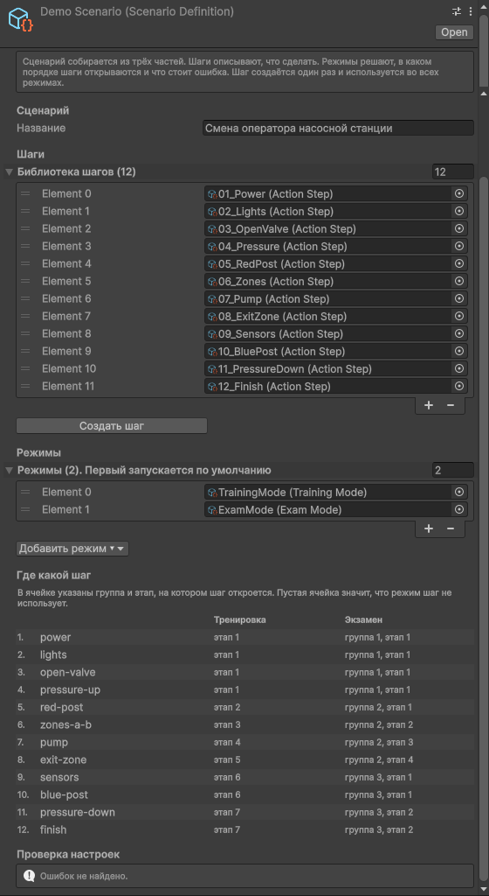
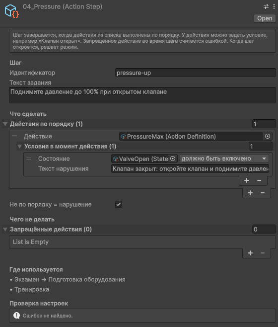
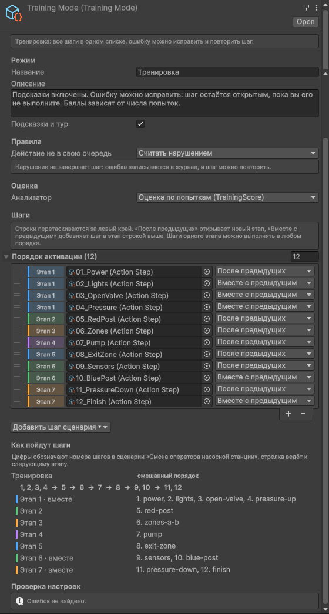
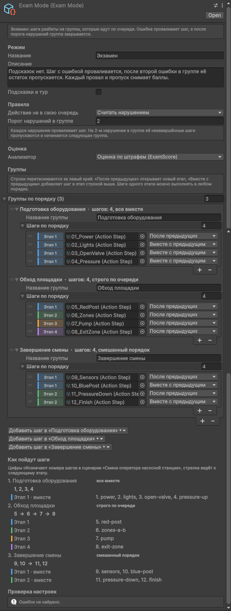
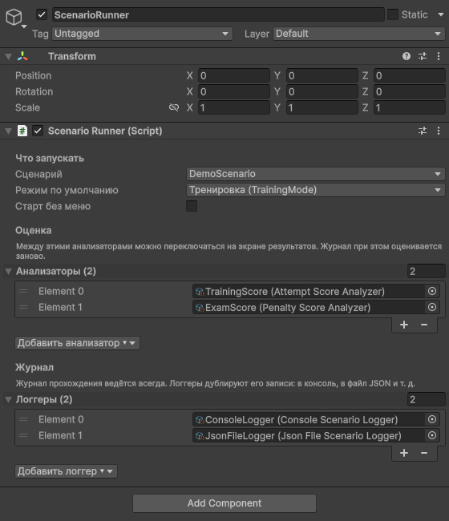
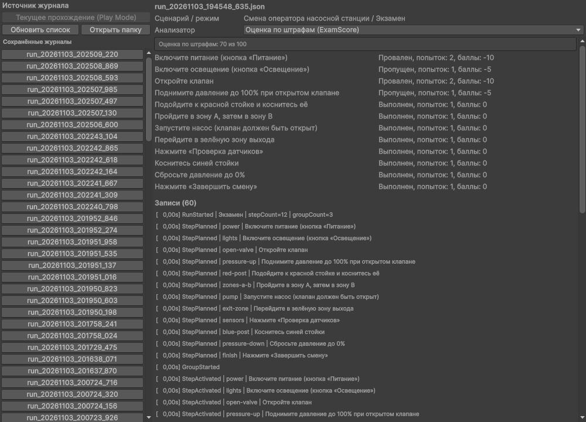

# Конструктор учебных сценариев (Unity)

Учебный сценарий собирается в инспекторе Unity из готовых шагов, код для этого писать не нужно.
Одни и те же шаги проходятся в двух режимах: в тренировке с подсказками и повторами и на экзамене
с группами и штрафами. Каждое действие попадает в журнал, а законченное прохождение можно оценить
заново другим анализатором.

Веб-версия: https://kantaevsherhan.github.io/scenario-builder/


| Обучающий тур | Экзамен: нарушение | Результаты | Журнал |
|---|---|---|---|
|  |  |  |  |

- Unity 6000.6.7f1, встроенный конвейер рендера, Input System, uGUI и TextMesh Pro.
- Сторонних ассетов и плагинов нет.
- Демо-сцена: `Assets/ScenarioBuilder/Demo/Scenes/DemoScenario.unity`.

## 1. Как запустить

- В браузере: https://kantaevsherhan.github.io/scenario-builder/. Скачивается около 8 МБ, пока идёт
  загрузка, видны проценты и скорость. При повторном заходе файлы берутся из кэша.
- Windows: распакуйте `ScenarioBuilder-Windows.zip` и запустите `ScenarioBuilder.exe`. Нужна вся папка:
  exe не работает без `ScenarioBuilder_Data` и dll рядом. Игра открывается на весь экран, в окне её
  запускает `ScenarioBuilder.exe -screen-fullscreen 0 -screen-width 1280 -screen-height 720`.
- Unity: откройте папку проекта в Unity Hub, затем демо-сцену, и нажмите Play.

На стартовом экране выберите режим и нажмите «Играть». В тренировке при первом запуске появится
короткий тур по интерфейсу.

Управление:

- Вы управляете белой капсулой: WASD или стрелки.
- Справа пульт с кнопками и ползунком «Давление».
- Слева список всех шагов. Синие нужно сделать сейчас, зелёные выполнены, красные провалены,
  оранжевые пропущены. На экзамене там же видно, какая группа идёт.
- Вверху переключение режима, «Заново», «Журнал», «Настройки» и «Выход». В веб-версии выхода нет,
  зато справа внизу есть кнопка «На весь экран».
- Esc закрывает открытое окно или тур. Если ничего не открыто, Esc выходит из игры, в редакторе
  останавливает Play Mode, а в браузере ничего не делает.

Как сцена отвечает на действия:

- то, что ждёт текущий шаг, мигает синим: кнопка на пульте, стойка, зона, клапан;
- выполненное становится зелёным, проваленное красным;
- в момент действия объект вспыхивает, при нарушении красным;
- при наведении мыши объект подсвечивается и показывает подсказку;
- у клапана идёт пар, у насоса вода, на щите искрит при включении и при аварийном стопе,
  кнопка «Освещение» включает лампы, у зон и стоек свои вспышки.

В тренировке тур на каждом новом этапе показывает, что делать: затемняет экран, оставляет вырез
вокруг нужной кнопки или объекта и подписывает его. «Далее» переходит к следующему заданию этапа,
«Пропустить» прячет подсказки до следующего этапа. В «Настройках» тур и подсветку можно выключить,
а тур пройти заново.

### Демо-сценарий «Смена оператора насосной станции»

| # | Шаг | Чем выполняется | Что проверяет |
|---|---|---|---|
| 1 | Включите питание | кнопка | «Аварийный стоп» во время шага считается нарушением |
| 2 | Включите освещение | кнопка | |
| 3 | Откройте клапан | кнопка, ставит состояние «Клапан открыт» | «Пуск насоса» во время шага считается нарушением |
| 4 | Поднимите давление до 100% при открытом клапане | ползунок (UnityEvent) | условие на состояние сцены |
| 5 | Коснитесь красной стойки | столкновение | |
| 6 | Пройдите в зону A, затем в зону B | два триггера | B раньше A считается нарушением |
| 7 | Запустите насос (клапан должен быть открыт) | кнопка | условие на состояние сцены |
| 8 | Перейдите в зону выхода | триггер | |
| 9 | Нажмите «Проверка датчиков» | кнопка | |
| 10 | Коснитесь синей стойки | столкновение | |
| 11 | Сбросьте давление до 0% | ползунок | |
| 12 | Нажмите «Завершить смену» | кнопка | |

Тренировка открывает шаги как в примере из задания: 1–4 вместе, затем 5, 6, 7, 8 по одному,
затем 9 и 10 вместе, затем 11 и 12 вместе.

Экзамен разбит на три группы, порог 2 нарушения:

- «Подготовка оборудования»: шаги 1–4 вместе;
- «Обход площадки»: шаги 5–8 по очереди;
- «Завершение смены»: 9 и 10, затем 11 и 12.

### Контрольные примеры руками

- Тренировка, 10 + 5 + 0. Нажмите «Освещение»: шаг выполнен сразу, 10 баллов. Нажмите «Пуск насоса»,
  потом «Открыть клапан»: одна ошибка, 5 баллов. Дважды нажмите «Аварийный стоп», потом «Питание»:
  две ошибки, 0 баллов. Баллы по шагам видны в окне результатов.
- Экзамен, 70 баллов. В первой группе нажмите «Аварийный стоп» (провален шаг 1), затем «Пуск насоса»
  (провален шаг 3). Это второе нарушение в группе, поэтому шаги 2 и 4 пропускаются и начинается
  вторая группа. Дальше всё без ошибок. Итог: 100 − 2×10 − 2×5 = 70.

Оба примера проверяются и автотестами.

## 2. Как собрать сценарий без кода

Всё настраивается ассетами в окне Project и компонентами в Inspector. Ассеты демо лежат
в `Assets/ScenarioBuilder/Demo/Data`. Новый ассет: правый клик в Project → Create → Scenario Builder.

### Сценарий

`DemoScenario` хранит название, библиотеку шагов и режимы. Шаг создаётся один раз, режимы на него
только ссылаются, поэтому копировать шаги под каждый режим не нужно. Таблица «Где какой шаг»
показывает, в какой группе и на каком этапе каждый режим открывает шаг. Ниже идёт проверка настроек:
пустые строки, повторы, шаг, забытый в одном из режимов.



### Шаг

Шаг описывает, что сделать, и не знает, в каком режиме его проходят.

- «Текст задания» видит пользователь.
- «Действия по порядку»: одно действие даёт простой шаг, несколько дают составной («зона A, затем зона B»).
- «Условия» у действия: состояние сцены, которое должно быть в этот момент, например «Клапан открыт».
  Если условие не выполнено, засчитывается нарушение с вашим текстом.
- «Запрещённые действия» во время шага считаются ошибкой.

Внизу видно, в каких режимах и группах шаг используется.



### Порядок шагов: этапы

В режиме каждая строка состоит из шага и способа его включения:

- «После предыдущих» начинает новый этап. Он откроется, когда завершатся все шаги выше.
- «Вместе с предыдущим» добавляет шаг в этап строки выше. Шаги одного этапа делаются в любом порядке.

Строки перетаскиваются за левый край. Цветная метка «Этап N» у строки пересчитывается сразу,
а блок «Как пойдут шаги» показывает итог одной строкой: `1, 2, 3, 4 → 5 → 6 → 7 → 8 → 9, 10 → 11, 12`.
Кнопка «Добавить шаг сценария» предлагает только шаги, которых в списке ещё нет.



### Экзамен: группы и порог

Группы идут одна за другой, у каждой свой список шагов с этапами. В заголовке группы написано,
сколько в ней шагов и как они открываются: все вместе, строго по очереди или смешанно.
«Порог нарушений в группе» в демо равен 2: на втором нарушении незавершённые шаги группы
пропускаются и начинается следующая.

У любого режима есть ещё три настройки:

- «Действие не в свою очередь»: считать нарушением шага, очередь которого не пришла, или игнорировать;
- «Подсказки и тур»: подсветка нужных объектов и обучающий тур;
- «Анализатор»: выпадающий список всех анализаторов проекта.



### Запуск, анализаторы и логгеры

Объект `ScenarioRunner` в сцене выбирает сценарий и режим по умолчанию. Анализаторы и логгеры
добавляются кнопками «Добавить анализатор» и «Добавить логгер». В меню есть ассеты проекта и пункт
«Создать новый» для каждого типа. Между анализаторами из списка можно переключаться на экране результатов.



### Как объекты сцены сообщают о действиях

На объект добавляется компонент-источник, в нём выбирается действие из `Actions/`:

| Компонент | Когда срабатывает |
|---|---|
| Button Action Source | нажали UI-кнопку на этом объекте |
| Trigger Action Source | объект с тегом (по умолчанию `Player`) вошёл в триггер или вышел из него |
| Collision Action Source | объект с тегом столкнулся с этим объектом |
| Unity Event Action Source | `RaiseAction` вызван из UnityEvent: ползунок, переключатель, свой компонент |
| State Flag Source | меняет состояние сцены (`SetOn`, `SetOff`, `Toggle`) |

Пример из демо: на кнопке «Открыть клапан» стоит Button Action Source с действием «Открыт клапан»,
а в её On Click добавлен `StateFlagSource.SetOn` клапана. Подсветку и эффекты дают компоненты
Action Feedback и Action Reaction, их поля объяснены во всплывающих подсказках.

### Журнал и переоценка

В игре журнал открывается кнопкой «Журнал», а после последнего шага появляется окно результатов
с кнопками анализаторов. В редакторе Tools → Scenario Builder → Журнал и анализ открывает сохранённые
JSON-журналы и оценивает их выбранным анализатором. Если данных не хватает (нет номера попытки или
плана шагов, прохождение прервано), анализатор пишет предупреждение и считает по тому, что есть.



Tools → Scenario Builder → Пересобрать демо-сцену и ассеты создаёт `Demo/Data` и сцену заново.
Ручные правки в этих ассетах при этом пропадут.

## 3. Как это устроено

```
Assets/ScenarioBuilder/
  Scripts/       сборка ScenarioBuilder.Runtime
    Core/        сценарий, действия, состояния сцены, ScenarioSession, ScenarioRunner, проверка настроек
    Steps/       StepDefinition и ActionStep
    Activation/  список «шаг + способ включения» → этапы
    Modes/       ScenarioMode, TrainingMode, ExamMode
    Sources/     компоненты, которые отправляют действия
    Feedback/    подсветка объектов и реакции на действия
    Logging/     JournalEntry, RunJournal, логгеры
    Analysis/    JournalSummary и анализаторы
    UI/          HUD, список шагов, окна, тур, настройки
  Editor/        инспекторы, окно журнала
  Demo/          компоненты демо, генератор сцены, ассеты, сцена
  Tests/         EditMode и PlayMode
```

Поток данных:

```
источник в сцене → ScenarioRunner → ScenarioSession → шаги, этапы, правила режима
                        │                 │
                        │                 └→ RunJournal → логгеры
                        │                         └→ анализатор → отчёт → окно результатов
                        └→ ActionRaised → подсветка, частицы, свет
```

- Шаг (`StepDefinition`) решает одно: что значит пришедшее действие. Ничего, шаг продвинулся, шаг
  выполнен или нарушение. Об очереди, попытках и баллах он не знает. Состояние прохождения хранится
  в `StepContext`, поэтому один ассет шага работает во всех режимах.
- `ActivationPlan` превращает список «шаг + После предыдущих / Вместе с предыдущим» в этапы.
- Режим (`ScenarioMode`) задаёт группы и решает, что делать с шагом после нарушения: повторить,
  провалить или провалить и пропустить остаток группы.
- `ScenarioSession` написан на чистом C# без MonoBehaviour. Он принимает действия, открывает этапы
  и группы, ловит действия вне очереди и пишет журнал. Поэтому вся логика проверяется EditMode-тестами
  без сцены.
- `ScenarioRunner` связывает сцену с сессией: запускает её в выбранном режиме, передаёт действия,
  отдаёт записи логгерам, в конце вызывает анализатор.
- Журнал служит общим форматом. У записи обязательны время, тип, шаг и результат, остальное
  (`attempt`, `outOfTurn`, `stepCount` и другие) хранится в полях «ключ: значение». Неизвестные типы
  записей и поля читатели пропускают, так что новые данные ничего не ломают.
- Анализатор читает только журнал. `JournalSummary` один раз сводит записи к фактам по шагам, а
  анализатор считает по ним баллы. Поэтому любой анализатор подходит к любому журналу, в том числе
  к файлу.
- Логгер только выводит записи. Журнал всегда хранит сессия, и замена логгеров на неё не влияет.
- Подсветка, эффекты, список шагов и тур слушают события раннера и сессии и в логику не вмешиваются.
  Что подсвечивать, они узнают у шага (`ExpectedActions`) и у источников (`Actions`).

### 3.1. Как расширять

- Тип шага: наследник `StepDefinition` с `Evaluate` и `Involves`, для подсказок ещё `ExpectedActions`.
  Сразу работает во всех режимах.
- Режим: наследник `ScenarioMode` с `Groups` и `ResolveViolation`. Его собственные поля инспектор
  покажет в блоке «Другие настройки».
- Логгер: наследник `ScenarioLogger` с `Write`, при необходимости `BeginRun` и `EndRun`.
  Появится в меню «Добавить логгер».
- Анализатор: наследник `ScenarioAnalyzer` с `Analyze(JournalSummary, warnings)`. Если данных
  не хватает, пишите предупреждение, а не бросайте исключение.
- Источник событий: наследник `ScenarioActionSource`, который вызывает `Raise(action)` и
  перечисляет свои действия в `Actions`.
- Новые данные в журнале: запись с новым `type` или поле через `entry.With("key", value)`.

### 3.2. Тесты

EditMode, 30 тестов:

- этапы, включая пример смешанной активации из задания;
- составные и контекстные шаги;
- сессия: повтор в тренировке, провал и пропуск группы на экзамене, действия вне очереди,
  порядок событий о нарушении, подсказка следующего действия;
- контрольные примеры 10 + 5 + 0 = 15 и 70;
- переоценка журнала после сохранения в JSON и неполные журналы;
- проверка настроек;
- демо-ассеты соответствуют заданию: 12 шагов, этапы тренировки, три группы экзамена, порог 2.

PlayMode, 8 тестов проходят демо-сцену через её настоящие входы: кнопки, ползунок, зоны и стойки.

- до «Играть» ничего не запущено, «Играть» запускает выбранный режим;
- тренировка без ошибок даёт максимум;
- тренировка 10 + 5 + 0;
- экзамен по контрольному примеру даёт 70;
- нарушение порядка зон даёт вторую попытку;
- клики мышью во время тура и сразу после него засчитываются.

Запуск: Window → General → Test Runner или из командной строки:

```bash
unity test . --mode EditMode
```

```bash
unity test . --mode PlayMode
```

### 3.3. Сборка

Меню Build → Windows и Build → WebGL (для WebGL нужен модуль Web в Unity Hub). Из командной строки:

```bash
unity run . -- -buildTarget Win64 -executeMethod ScenarioBuilder.Build.WindowsBuild.BuildFromCommandLine
```

```bash
unity run . -- -buildTarget WebGL -executeMethod ScenarioBuilder.Build.WebGLBuild.BuildFromCommandLine
```

Сборки появляются в `Builds/Windows` и `Builds/WebGL`, в git папка `Builds/` не попадает.
Журналы JSON сборка для Windows пишет в
`%USERPROFILE%\AppData\LocalLow\DefaultCompany\ScenarioBuilder\Journals`, лог `Player.log` лежит
уровнем выше.

Веб-сборка не сжата: GitHub Pages сам отдаёт файлы в gzip, а заголовки для `.br` и `.gz` выставить
не даёт. Страница сделана по шаблону `Assets/WebGLTemplates/Responsive`. Открыть `index.html` с диска
не выйдет, локально нужен http-сервер:

```bash
python -m http.server 8000 --directory Builds/WebGL
```

Сайт берётся из ветки `gh-pages`, в ней лежит только содержимое `Builds/WebGL` и пустой `.nojekyll`.
Чтобы обновить его, создайте рабочую копию ветки:

```bash
git worktree add ../scenario-builder-pages gh-pages
```

Затем замените в `../scenario-builder-pages` всё, кроме `.git` и `.nojekyll`, файлами из `Builds/WebGL`,
сделайте там коммит и `git push origin gh-pages`.

## 4. Что улучшил бы

- Перекрывающиеся группы экзамена. Сейчас они идут строго одна за другой. Можно добавить правило
  «группа открывается вместе с предыдущей», как у шагов.
- Отдельное окно редактора сценария: этапы в виде схемы и перенос шагов между группами
  перетаскиванием. Сейчас шаг удаляют из одной группы и добавляют в другую.
- Типы шагов «любое из действий», «держать состояние N секунд», шаг на время.
- Локализация. Сейчас русские тексты лежат прямо в ассетах.
- Действия для шагов будущих групп экзамена просто игнорируются. Это упрощение, его стоит обсудить.
- Открытие сохранённых журналов в самой игре, а не только в окне редактора.
- Звук для реакций: компонент это позволяет, но в демо звуков нет.
- Генератор демо-сцены удобен для повторяемости, но для ручной правки лучше подошли бы префабы.

## 5. Затраченное время

По истории коммитов работа заняла один день: первый коммит в 14:09, последний в main около 21:05,
то есть около 7 часов. В этот промежуток входят два длинных отрезка без коммитов
(14:44–16:57 и 16:57–19:15), и сколько в них было перерывов, по истории не видно.
После этого ушло ещё немного времени на финальные сборки и проверку.
